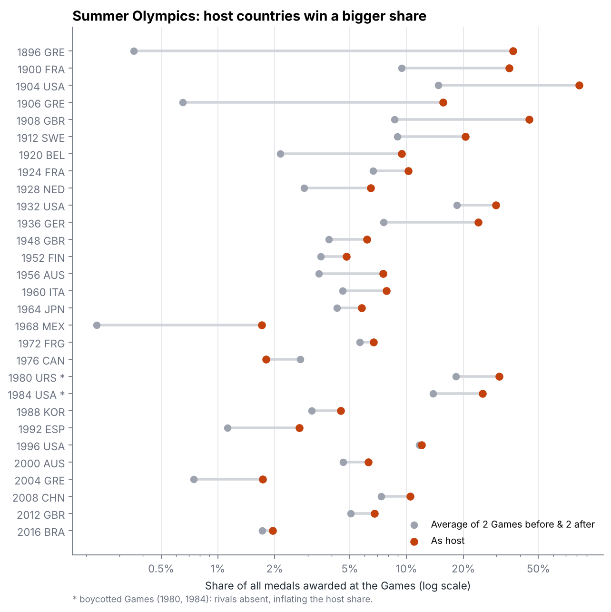
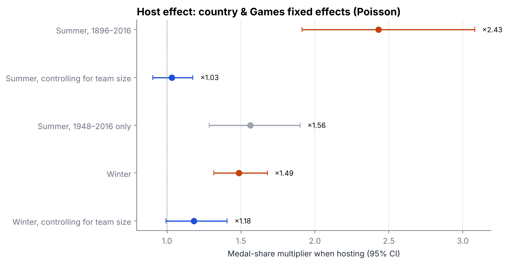
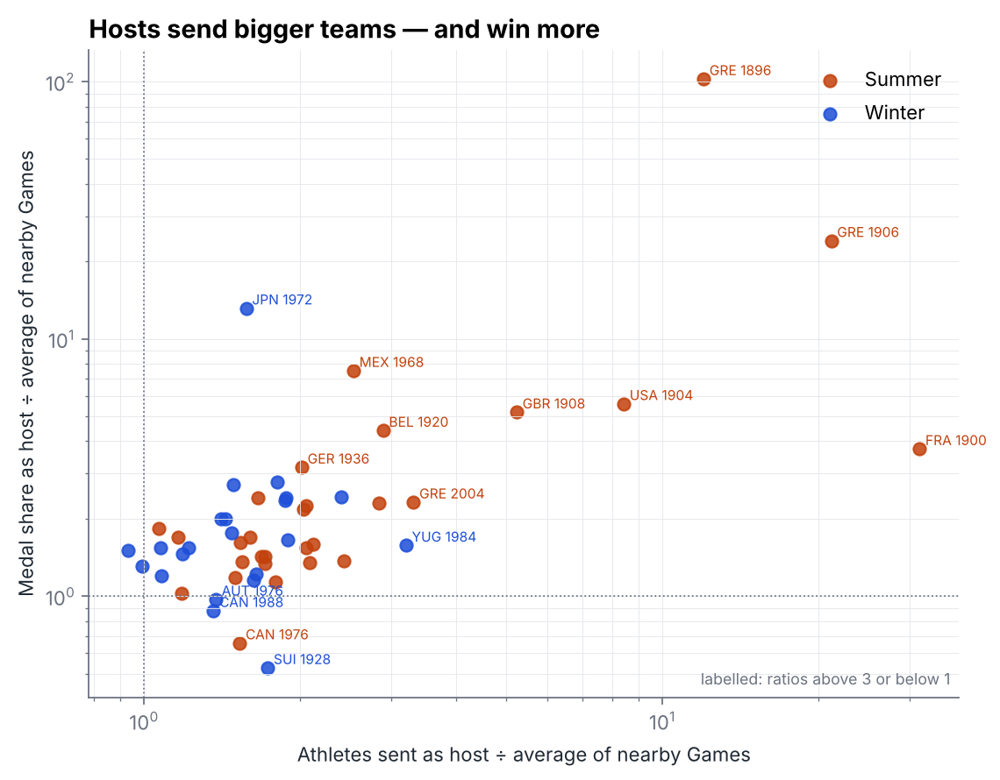
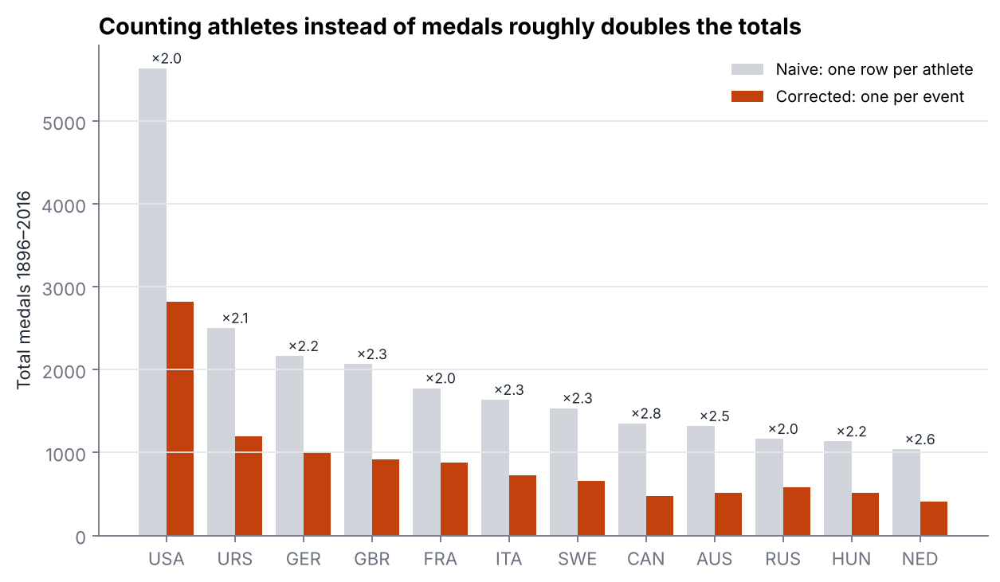

# Do Host Countries Win More Olympic Medals?

120 years of Olympic results (1896–2016, 271,116 athlete entries) to measure the home advantage. The project compares each host with *itself* at nearby Games, and fixes a counting mistake that is easy to make with this dataset.



## Findings

| Question | Answer |
|---|---|
| Do hosts do better? | **Yes, almost always.** 28 of 29 Summer hosts won a bigger share of all medals than in their 2 Games before and 2 after (the exception: Canada 1976, which won no gold at home). 19 of 22 Winter hosts did too. |
| By how much? | Median medal share as host is **1.70×** the nearby-Games average for Summer (**1.42×** since 1948) and **1.56×** for Winter. |
| Controlling for country and Games | Poisson model with country and Games fixed effects: hosting multiplies medal share by **×2.43** in Summer (95% CI 1.91–3.08), **×1.56** if only 1948–2016 is used, and **×1.49** in Winter (1.32–1.68). |
| Is it just bigger teams? | Hosts send a median **2.0×** as many athletes in Summer (1.5× in Winter). Adding team size to the model shrinks the Summer host effect to **×1.03** (CI 0.90–1.18, no longer significant) and the Winter effect to **×1.18** (CI 0.99–1.41, p = 0.06). |

**Reading the last row carefully:** team size is part of *how* the host advantage works (hosts get automatic qualification places in many sports and enter more events), so this does not mean hosting "doesn't matter". It means that in Summer, once a country is at home, its medals per athlete look about the same as usual. The extra medals come from having more athletes competing. In Winter, part of the effect remains even after accounting for team size. Team size is also chosen with expected success in mind, so this decomposition is descriptive, not causal.





## The data trap: athletes are not medals

The dataset has one row per **athlete**, so a basketball gold shows up 12 times (once per player), and a relay gold 4 times. Counting rows gives **39,783** "medals"; counting each (Games, event, country, medal) once gives **18,905**. Team-heavy nations are inflated the most (Canada ×2.8, Netherlands ×2.6, Australia ×2.5).



The corrected counts match official medal tables:

| Games, country | Naive rows | Corrected | Official |
|---|---:|---:|---:|
| 2008 Beijing, China | 184 | **100** | 100 |
| 2012 London, Great Britain | 126 | **65** | 65 |
| 1980 Moscow, Soviet Union | 442 | **195** | 195 |
| 2016 Rio, USA | 264 | **121** | 121 |
| 2014 Sochi, Russia | 68 | **33** | 33 (before later doping reallocations) |
| 1984 Los Angeles, USA | 352 | **173** | 174 |

The one-medal gap for 1984 shows the rule's known limitation: when *two* athletes from the same country share a bronze in the same event (boxing, judo and wrestling award two bronzes), the rule counts one.

## Method

- **Medal share** = a country's medals ÷ all medals awarded at that Games, which accounts for the number of events growing from 43 (1896) to over 300.
- **Before/after comparison:** for each host, the mean share at the 2 preceding and 2 following Games of the same season in which the country competed.
- **Fixed-effects model:** Poisson GLM, `medals ~ host + country FE + Games FE`, with log(total medals at the Games) as offset, so exp(β) is a multiplier on medal share. Standard errors are clustered by country. Countries that never won a medal in that season are dropped. A second version adds log(athletes sent).
- **Hosts:** 29 Summer (incl. the 1906 Intercalated Games) and 22 Winter host nations, hard-coded and checked against the data. 1956 Summer is credited to Australia (Melbourne); the equestrian events held in Stockholm are part of the same Games.
- **Boycotts:** 1980 (US-led) and 1984 (Soviet-led) are flagged with * in the first figure. Excluding them leaves the Summer median ratio unchanged at 1.70.

## Limitations

- Early Games (1896–1908) were small and mostly local, which produces extreme host ratios (Greece 1896: 37% of all medals). That's why the 1948–2016 estimate is also reported.
- Data ends in 2016 (Tokyo 2020, Paris 2024 not included).
- Country codes change over time (Germany: GER/FRG/GDR; Soviet Union: URS/EUN/RUS); they are treated as separate countries, not merged.

## Run

```bash
pip install pandas numpy statsmodels matplotlib
python analyze.py          # reads data/raw/, writes output/  (~10 s)
```

**Source:** [TidyTuesday 2024-08-06](https://github.com/rfordatascience/tidytuesday/tree/main/data/2024/2024-08-06) — Olympic athletes and events data originally scraped from Sports Reference.

*Author: Axror Abduhamitov, 2026*
